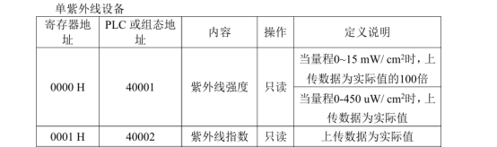

# 智能大棚传感器配置

### 波特率全部是9600

# 1\.一氧化碳传感器

## 1\.1设备地址为01

# 2\.紫外线传感器

## 2\.1设备地址为02

# 3\.氧气传感器

## 3\.1设备地址为03

# 4\.CO2光照温湿度四合一传感器

## 4\.1设备地址为04

# 5\.扁卡轨大气压力温湿/温湿度传感器（棚外）

## 5\.1设备地址为05

# 6\.扁卡轨大气压力温湿/温湿度传感器（棚内）

## 6\.1设备地址为06

# 目前状态：
## 棚外
###     ✅气压温湿度传感器
        1.气压
        2.温度
        3.湿度
## 棚内
###     ✅气压温湿度传感器
        4.气压
        5.温度
        6.湿度
###     ✅氧气传感器
        7.氧气
###    一氧化碳传感器
        8.一氧化碳
###     ✅光照二氧化碳温湿度传感器
        9.光照
        10.二氧化碳
        11.温度
        12.湿度
###     ✅紫外线传感器
        13.紫外线